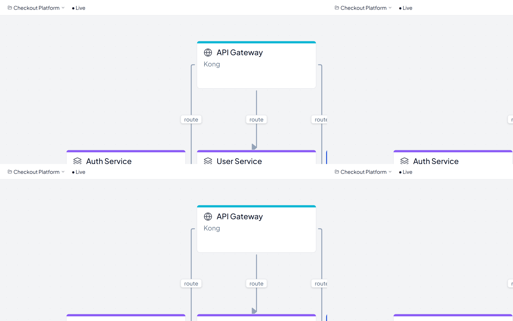
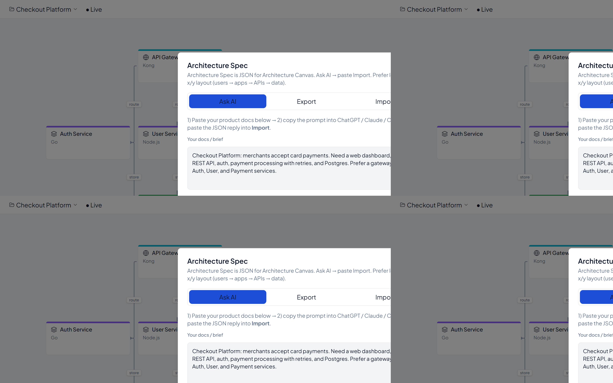
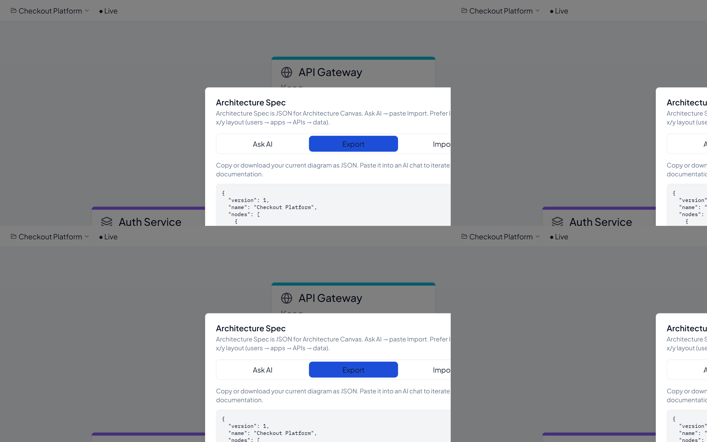
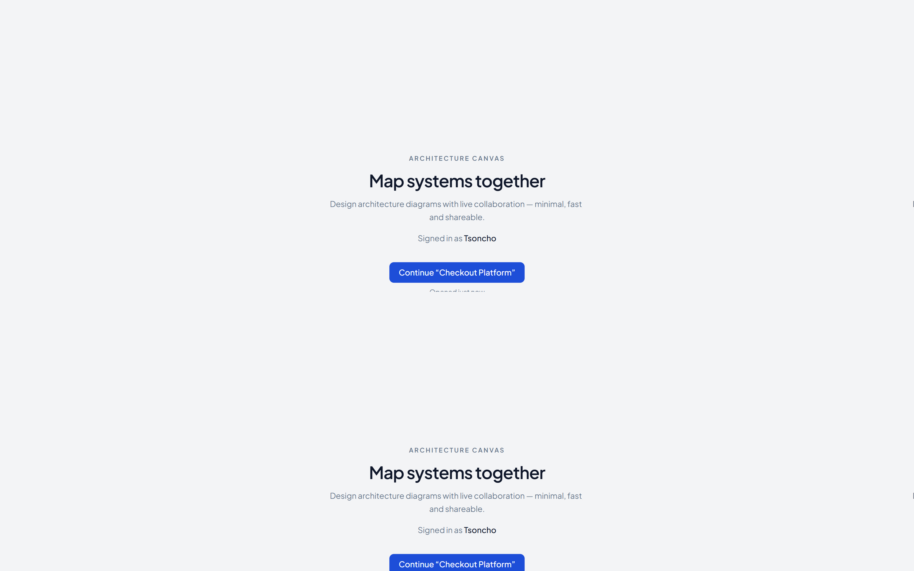
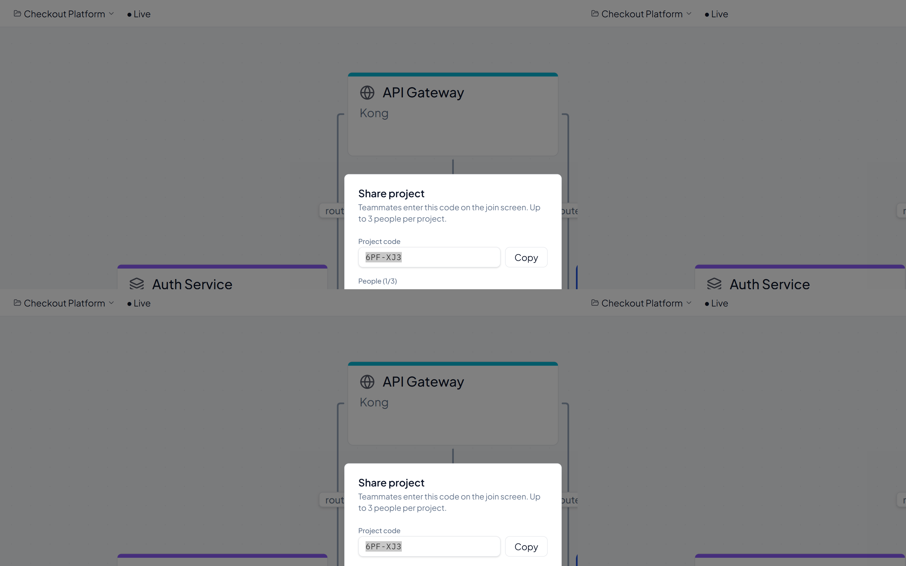
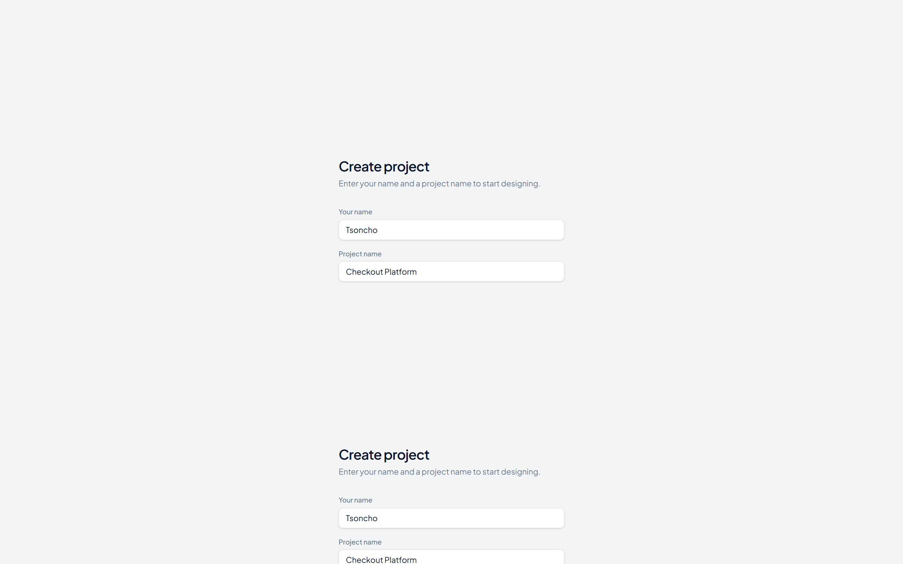

# Architecture Canvas

**A tiny, collaborative architecture diagramming app for Windows** — open it, create a project, enter your name, start designing.

> Think “Figma for system architecture,” without the enterprise complexity.

[](https://github.com/tsoncho/architecture-canvas/releases/latest)
[](LICENSE)


## Screenshots

<p align="center">
  
  <br />
  <sub>Live canvas — microservices template, selected node, property panel</sub>
</p>

<p align="center">
  
  &nbsp;
  
  <br />
  <sub>Spec ↔ AI — ask any model, then export/import the JSON</sub>
</p>

<p align="center">
  
  &nbsp;
  
  <br />
  <sub>Welcome / share — resume work, invite teammates with a short code</sub>
</p>

<p align="center">
  
  <br />
  <sub>Create — name it and start from Blank, Web, Mobile, or Microservices</sub>
</p>

## Why this exists

Most architecture tools are either whiteboards (too freeform) or enterprise suites (too heavy). Architecture Canvas is intentionally small:

- Launch → create or join with a short code (`7K2-FQ9`)
- Drop apps, APIs, databases, queues, users…
- Connect them, collaborate live (up to 3 people)
- Export / import an **Architecture Spec** JSON so AIs can generate or refine diagrams

## Download (Windows)

### One-liner (PowerShell)

```powershell
irm https://raw.githubusercontent.com/tsoncho/architecture-canvas/master/scripts/install.ps1 | iex
```

That downloads the latest setup from GitHub Releases and launches the installer.

### Manual

Grab the latest installer from **[Releases](https://github.com/tsoncho/architecture-canvas/releases/latest)**:

`Architecture.Canvas_*_x64-setup.exe`

Installed builds **auto-update** from GitHub Releases (signed updater).

## Features

- Infinite canvas with pan / zoom / multi-select
- Architecture-oriented node types + groups + text notes
- Realtime collaboration + presence avatars
- Local-first edits with offline queue → Supabase sync
- Architecture Spec: AI prompt → JSON → canvas (and export back out)
- Keyboard-first shortcuts (`N`, delete, undo/redo, copy/paste)

## Architecture Spec (AI bridge)

```text
Product docs  →  any AI  →  Spec JSON  →  Import into canvas
                      ↑________________↓
                         Export Spec
```

See [`docs/architecture-spec.md`](docs/architecture-spec.md).

## Tech stack

| Layer | Choice |
|-------|--------|
| Desktop | Tauri 2 (NSIS installer) |
| UI | React, TypeScript, Vite, Tailwind |
| Canvas | XYFlow |
| State | Zustand + IndexedDB |
| Backend | Supabase (Postgres, Realtime, RLS) |
| Updates | Tauri updater → GitHub Releases |

```text
User action → local UI → undo stack → IndexedDB outbox → Supabase → Realtime peers
```

## Develop

**Prerequisites:** Node 20+, Rust (rustup), VS 2022 C++ Build Tools, WebView2.

```bash
git clone https://github.com/tsoncho/architecture-canvas.git
cd architecture-canvas
npm install
cp .env.example .env   # set VITE_SUPABASE_URL + VITE_SUPABASE_ANON_KEY
npm run tauri:dev      # desktop
# or
npm run dev            # browser UI on :1420
```

Apply SQL in [`supabase/migrations/`](supabase/migrations/) to your Supabase project.

### Build installer locally

```bash
# Requires TAURI_SIGNING_PRIVATE_KEY for updater artifacts
npm run tauri:build
```

Output: `src-tauri/target/release/bundle/nsis/`

## Releases & auto-update

1. Bump `version` in `package.json` and `src-tauri/tauri.conf.json` (and `Cargo.toml` if needed)
2. Commit, then tag and push:
   ```bash
   git tag v0.1.1
   git push origin v0.1.1
   ```
3. GitHub Actions builds Windows NSIS + `latest.json` and publishes a Release
4. Installed apps check that release and update quietly

Repo secrets required for CI:

- `TAURI_SIGNING_PRIVATE_KEY`
- `TAURI_SIGNING_PRIVATE_KEY_PASSWORD` (empty if the key has no password)

## Project layout

```text
src/                 React app (pages, canvas, sync, Spec)
src-tauri/           Tauri shell + Windows packaging
supabase/migrations  Schema, RLS, join/create RPCs
docs/                Architecture Spec format
.github/workflows    Release + updater artifacts
```

## License

MIT — see [LICENSE](LICENSE).

---

Built as a focused portfolio project: real desktop packaging, realtime collaboration, local-first sync, and an AI-friendly diagram interchange format.
